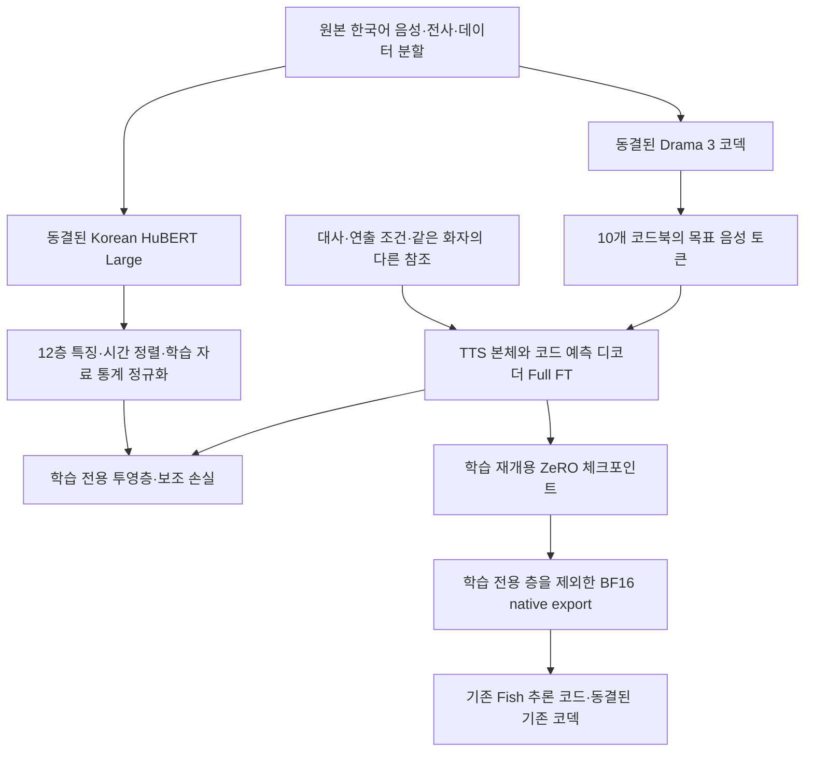
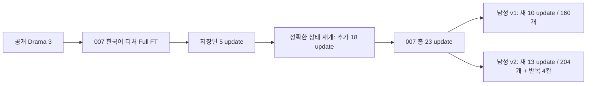

# Miro 음성 모델 학습 이력과 기술·비용 회고

- 문서 버전: 1.0
- 작성일: 2026-10-27, 한국 시간 기준
- 대상: Miro 운영자와 후속 개발자
- 범위: GPT-SoVITS·Qwen 등 초기 시도부터 Drama 3 기반 한국어 티처 Full FT, 남성 ASMR 적응, 저장·복구·비용 관리까지
- 근거: 현재 Mac에 남은 코드, 데이터 명세, 실행 결과, 청구 스냅샷, 이전 인수인계 기록
- 작성 시 앱 저장소 기준 커밋: `07fc57cbafe68dbf12adbeda411fde31a142b85c`. 학습 실행의 고정 소스 revision과는 별개다.
- 이 문서 작성 중 새 학습·유료 추론·결제·클라우드 상태 변경은 하지 않았다. 클라우드의 현재 파일 존속과 미결제 잔액을 새로 조회한 보고서도 아니다.

## 1. 현재 상태부터 정리

실제로 만든 것은 **Drama 3의 사전 학습된 TTS 가중치를 이어 학습한 Miro 전용 음성 체크포인트**다. 대화 내용을 만드는 앱의 채팅 LLM을 새로 학습한 작업은 아니다.

| 항목 | 확인된 상태 |
| --- | --- |
| 학습 방식 | LoRA 없이 TTS 본체·음성 코드 예측 디코더 전체 Full FT |
| 학습 대상 크기 | TTS 파라미터 35,899,643,008개, 약 35.9B |
| 원래 Drama 3 코덱 | 동결. VQ 코드북 재학습이나 원래 시멘틱 티처 교체를 하지 않음 |
| 한국어 티처 | Korean HuBERT Large를 학습 전용 보조 목표로 사용 |
| 007 기반 모델 | 총 23 optimizer updates까지 진행·저장. 목표 25회는 완료하지 못함 |
| 남성 ASMR 첫 적응 | 007의 23회 TTS 가중치에서 새 단계 10 updates 완료·저장·비교. 품질 기준 미통과 |
| 남성 ASMR 두 번째 적응 | 다시 007의 23회 TTS 가중치에서 새 단계 13 updates 완료·저장. 별도 엔진 재개·native export·새 음성 비교는 미완료 |
| 최신 모델 음질 | 학습 전보다 좋아졌다고 확인할 수 없음. 13회 모델은 새 음성을 아직 평가하지 못함 |
| 공통 한국어 기반 모델 | 여러 화자에 대한 일반화가 검증된 기반 모델은 아직 아님 |
| 앱 출시 상태 | 음성은 보류. 리얼리티 인터랙션·문자·상황 이미지 중심으로 진행 |

**저장 성공, 재개 성공, 대사 완주, 목소리 유사도, 사람 같은 연기는 서로 다른 완료 조건이다.** 하나가 통과했다고 나머지를 통과한 것으로 기록하지 않는다. [S01–S04]

## 2. 처음 원했던 제품과 기술 선택

Miro의 정체성은 **음성 캐릭터챗**이다. 목표는 또박또박 읽는 낭독기가 아니라, 같은 캐릭터의 목소리로 맥락에 맞는 감정·속도·강약·머뭇거림·속삭임·숨을 표현하는 것이다. 언베일도 제품 평가 범위에 포함하되, 그 용도에 맞는 동의와 실제 학습 자료가 확보된 범위로 한정한다.

초기에는 목소리 복제와 연기 자연스러움을 같은 문제로 취급하기 쉬웠다. 실제로는 최소 네 가지가 분리된다.

1. **발음·내용:** 입력한 한국어를 빠짐없이 말하는가.
2. **화자:** 누가 말하든 목표 인물의 음색을 유지하는가.
3. **연기:** 감정·속삭임·속도·쉼이 상황에 맞는가.
4. **서비스:** 지연·실패율·원가·중복 과금·재생·취소가 감당 가능한가.

Full FT는 위 문제를 개선하기 위한 학습 방식이지, 네 가지가 자동으로 해결되는 보증은 아니다.

### 주요 시점

| 시점 | 진행 내용 | 다음 단계로 남은 것 |
| --- | --- | --- |
| 10/22 인수인계 | GPT-SoVITS·Qwen 등의 낭독감과 억양 감소를 확인 | 연기 데이터·모델 비교, 원인 분리 |
| 10/23 전후 | Drama 3 선택, 한국어 티처·실제 크기 Full FT 경로 구현·검사 | 충분한 학습과 동일 조건 품질 대조 |
| 10/24 | 저장 실패 감사, 정상 5회 저장·새 엔진 재개, 23회까지 연속 학습·비교 | 다중 화자 일반화와 연기 품질 |
| 10/26 전반 | 남성 ASMR 한 명의 160개로 10 updates, 첫 단어만 나오는 문제 조사 | 완주·목소리·연기 기준 통과 |
| 10/26 후반 | 새 대본 비교 후 23회에서 별도 13 updates, 204개 전체 사용 후보 학습·저장 | 계정 제한으로 최신 모델 재개·export·새 음성 평가 대기 |
| 10/27 문서화 | 로컬 증거와 코드로 이력 재구성 | 이 문서 자체로 새 유료 작업을 시작하지 않음 |

## 3. 초기 모델 시도와 방향 전환

### 3.1 GPT-SoVITS

2026-10-22 인수인계 기준으로 Modal T4에서 GPT-SoVITS v2를 파인튜닝하고, Mac의 `gsv_server`와 ngrok를 통해 합성하는 구조였다. 기록된 과거 비용은 목소리당 학습 약 4–10분, $0.1–0.3이었다. 이는 과거 인수인계의 범위이며 이번에 전체 청구서를 재정산한 결과가 아니다.

당시 데이터 정제 경로에는 음악이 있을 때만 Demucs, 음량 정규화, 슬라이싱, PANNs 기반 효과음·발성 분류, faster-whisper 전사, 화자 필터가 포함돼 있었다. 이 정제 설정을 이후 모든 Drama 3 데이터에 동일하게 적용했다고 보면 안 된다.

600문장 학습, 감정별 참조, temperature·top-k 조정을 시도했지만 사용자 청취에서는 대본 읽는 느낌을 해소하지 못했다.

### 3.2 Qwen과 다른 모델

| 시도 | 남아 있는 기록으로 말할 수 있는 것 | 단정할 수 없는 것 |
| --- | --- | --- |
| Qwen3-TTS 1.7B zero-shot | 초기에는 참조 3–8초와 대본으로 비교. 이후 사용자는 새 클로닝 결과를 상대적으로 선호 | 모든 Qwen 버전·학습 구조의 우열 |
| Qwen 파인튜닝 | 10/21 시도는 시간 제한으로 결과물 없이 중단됐다는 인수인계가 있음. 이후 조건·구절·맥락 제어 학습 코드도 존재 | 현재 남은 자료만으로 후속 각 실행의 최종 update 수·청구액을 모두 확정하는 것 |
| OpenAI TTS | 구어체 지시문을 넣은 비교에서도 사용자는 AI 같다고 평가 | 파인튜닝을 완료했다는 주장. 이 비교는 지시문 기반 합성과 구분해야 함 |
| VoxCPM2·Chatterbox·F5 계열 | 비교 요청과 일부 실행 코드가 남아 있음 | 각 요청이 전부 성공해 동일 조건 음성을 확보했다는 주장. 초기 결과물이 정리돼 현재 근거가 불완전함 |
| 타입캐스트·ElevenLabs | 상용 비교를 시도했고 ElevenLabs는 사용자가 진행하지 않기로 함 | ElevenLabs에서 학습·비교를 완료했다는 주장 |
| Drama 3 | 비교 후 사용자가 가장 낫다고 선택. 이후 Full FT의 출발 모델로 채택 | 한국어 기반 학습과 프로덕션 연기가 이미 완성됐다는 주장 |

초기 자료가 삭제·정리된 실험은 **요청 이력, 구현 코드 존재, 실제 실행 완료**를 구분해야 한다. 이 문서는 남아 있지 않은 성공 결과나 비용을 만들어 채우지 않는다. [S05]

### 3.3 초기 억양 측정과 뒤늦게 정정된 데이터 해석

인수인계에는 007의 실제 녹음 6문장과 생성 음성을 비교한 수치가 있다.

| 음성 | 피치 폭, 반음 | 억양 모양 일치 | 길이, 초 | 쉼 비율 |
| --- | ---: | ---: | ---: | ---: |
| 실제 녹음 | 14.6 | 1.00 | 5.1 | 0.19 |
| GPT-SoVITS 운영 | 10.4 | 0.57 | 4.9 | 0.19 |
| GPT-SoVITS temperature 1.3 | 12.8 | 0.65 | 5.0 | 0.20 |
| Qwen zero-shot | 10.8 | 0.44 | 4.6 | 0.13 |

이 표는 해당 6문장의 관측이지 모델 전체의 객관적 순위가 아니다. 억양 모양이 다르다고 항상 부자연스러운 것도 아니다. 자연스러운 연기에는 여러 정답이 있을 수 있다.

초기에는 “데이터가 전부 무감정 낭독이어서 그렇다”는 설명이 나왔지만, 후속 메타데이터 감사에서 **007의 600개에는 무감정 250·기쁨 150·분노 100·슬픔 100개 라벨**이 있었다. 따라서 그 초기 설명은 정확하지 않았다. 다만 같은 대사를 여러 감정으로 녹음한 짝은 확인되지 않았고, 전체 라벨을 사람이 청취 검증한 것은 아니다.

성별 메타데이터로 확인한 007은 여성이다. 당시 보유 12명·7,200클립도 여성 자료였다. 남성 001·011 등을 찾았을 때는 라벨만 있고 원본 WAV가 없었으며 AI Hub 다운로드 경로에서 502 오류가 관측됐다. 남성 자료가 준비된 것으로 오인해 GPU를 시작하면 안 되는 이유였다. [S06–S08]

## 4. Drama 3 기반 Miro Full FT의 실제 구조

### 4.1 기반 모델과 학습 범위

공개 Drama 3의 추론 구조·가중치를 출발점으로 사용했다. 공식 학습 레시피를 그대로 실행한 것이 아니라, 공개 추론 구조에 맞춰 별도의 Full FT 학습 경로를 구현했다.

- 기반 Fish 소스 revision: `541566932abbaebcb0a40e562a1f846738383f38`
- 기반 모델 revision: `b2b5ee998034b2975720906c815e7fb0e9f007bd`
- FP8 전문가 가중치를 학습 가능한 BF16 파라미터로 변환했다. 원래 양자화 이전 정밀도를 복구한 것은 아니다.
- 임베딩, attention 계층, MoE 전문가·라우터, 출력층, 음성 코드 예측 디코더 전체를 학습 대상으로 삼았다.
- LoRA나 화자별 어댑터를 끼우는 방식이 아니다.
- 별도 음성 코덱과 한국어 HuBERT 티처는 동결했다.

**Full FT의 “전체”는 이 실험의 TTS 생성 모델 전체를 뜻한다. 코덱·티처·앱 채팅 LLM까지 모두 업데이트했다는 뜻이 아니다.** [S09–S11]

### 4.2 데이터에서 출력까지



학습 예제에는 목표 녹음과 동일 화자의 별도 참조를 붙인다. 모델의 `speaker0`–`speaker15`는 요청 안의 역할 슬롯이며 영구적으로 특정 사람을 뜻하는 ID가 아니다. 관리용 `speaker_id`와 혼동하면 안 된다.

하나의 모델로 여러 화자를 다루도록 준비한 구조는 있지만, 실제 후속 남성 학습 데이터는 사용자가 확인한 **한 사람**이다. 남성 두 사람에 대한 유지·간섭·일반화 검증은 하지 못했다.

### 4.3 한국어 HuBERT 티처의 정확한 역할

사용한 티처는 `team-lucid/hubert-large-korean`, revision `62054d17ebf51437336a371a2cdd80d5da2b44ac`다. 코드에서는 12층의 1,024차원 특징을 사용한다.

1. 티처 입력은 16kHz로 준비한다. 공식 전처리의 `do_normalize=false`를 유지한다.
2. 티처 특징을 기존 44.1kHz 코덱의 프레임 중심에 선형 보간한다.
3. 평균·표준편차는 학습 분할에서만 계산한다. 평가 자료를 통계 계산에 넣지 않는다.
4. 표준편차 하한 0.05, 정규화 결과 범위 ±10을 적용한다.
5. TTS 은닉 상태에 학습 전용 선형 투영층을 붙여 해당 음성 프레임의 티처 표현을 예측한다.
6. 추론용 export에서는 티처와 이 투영층을 제외한다.

이 시간 정렬은 프레임 중심의 근사 대응이며 음소별 강제 정렬은 아니다. 12층이 최적이라는 검증도 없다.

현재 코드의 손실 구조는 다음과 같다.

```text
L_speech = 0.5 × L_semantic + 0.5 × L_codebook
           + L_EOS + λ_router × L_router

L_KO = mean(1 - cosine(W h_t, stop_gradient(z_t)))

L_total = L_speech + 0.1 × L_KO
```

- `h_t`: 다음 목표 음성 프레임을 예측하기 직전의 TTS 은닉 상태
- `z_t`: 해당 프레임에 정렬·정규화한 한국어 티처 특징
- `W`: 학습 전용 투영층
- 본문·참조 자체를 예측 대상으로 삼지 않고 assistant 목표 음성 프레임과 EOS에 감독을 건다.
- 뒤 코드북은 같은 목표 프레임의 앞 코드북을 조건으로 예측한다. 프레임을 이중으로 한 칸 밀지 않는다.

사용자가 제기한 세 병목 중 이 실험은 **한국어 표현을 TTS 학습에 더 반영하는 우회 경로**다. VQ 정보 손실을 없앴거나 코덱 학습 분포를 한국어로 바꾼 것은 아니다. 원래 코덱의 티처를 Korean HuBERT로 교체했다는 설명도 틀리다. [S09–S11]

### 4.4 분산 학습 설정

실제 큰 모델 실행에서는 8×H100, BF16, DeepSpeed ZeRO stage 3, CPU optimizer offload, activation checkpointing을 사용했다. 큰 파라미터·기울기·optimizer 상태를 나눠 보관하고 activation 메모리를 줄이기 위한 선택이다.

각 단계의 **실행 스냅샷**이 설정의 기준이다. 공용 `zero3.json` 기본 accumulation 값과 실제 단계에서 덮어쓴 값은 다를 수 있다. 007 후반 및 남성 단계는 GPU당 micro-batch 1, GPU 8장, accumulation 2로 **전역 batch 16**이었다.

새 남성 단계의 기록된 학습률은 TTS `1e-6`, 티처 투영층 `5e-4`, 티처 손실 가중치 `0.1`이다. [S12–S14]

### 4.5 실제 큰 모델을 돌리기 전의 축소 검사

동일한 네이티브 연산 구조를 줄인 약 85.1M 파라미터 모델에서 전체 파라미터 역전파, 2GPU ZeRO 저장·재구성, 티처 투영층을 제외한 native 재로딩을 먼저 검사했다. 이 축소 TTS는 무작위 초기화이며, 사전 학습 Drama 3의 음질 시험이 아니다.

실제 007 자료를 사용해 기존 손실·한국어 티처·다른 녹음의 티처를 준 대조군을 초기값 3개로 각각 64 updates씩 비교했다. 총 9실행·576 updates이며, 올바른 티처가 기존보다 좋아진 경우는 세 초기값 중 한 번이었다. 평균 상대 검증 손실 변화는 약 +0.577%로 일관된 개선이 없었다.

이후 실제 35.9B 모델의 1 update 통합 검사도 완료했지만, 그것은 큰 모델에서 학습 경로가 동작한다는 증거였다. 사용자가 원한 충분한 학습이나 품질 우위의 증거는 아니었다. 큰 모델의 동일 조건 A/B는 결제 제한 등으로 완성하지 못했고, 후반에는 예산상 한국어 티처 분기 하나를 중심으로 진행했다. [S01]

## 5. “몇 회 학습했나”의 단위와 모델 계보

### 5.1 Update, micro-batch, epoch

```text
전역 batch = GPU 수 × GPU당 micro-batch × gradient accumulation
           = 8 × 1 × 2 = 16예제 / optimizer update

예제 제시 횟수 = optimizer updates × 전역 batch
```

| 단계 | Updates | 학습 목표 제시 횟수 | 의미 |
| --- | ---: | ---: | --- |
| 007 모델 | 23 | 368 | 학습 분할 531개 대비 약 0.693순회 분량. 23 epoch가 아님 |
| 남성 v1 | 10 | 160 | 고유 학습 클립 160개를 한 번씩 사용 |
| 남성 v2 | 13 | 208 | 고유 204개를 한 번씩 사용하고 마지막 4칸은 명시적 반복 |

007 학습 감사에서 실제 제시된 고유 목표는 368개, 약 26.49분이었다. 600개가 모두 매번 학습됐다고 설명하면 틀린다. 참조 음성 제시량을 고유 목표 학습량에 더해서도 안 된다. [S07]

### 5.2 모델이 이어진 경로



**최신 13회는 남성 10회 모델에 13회를 더한 것이 아니다.** 새 대본 비교에서 상대적으로 안정적이었던 007의 23회 가중치를 다시 출발점으로 삼은 별도 분기다. 따라서 최신 계보는 `23 + 13 = 36`이며 `23 + 10 + 13 = 46`이 아니다.

같은 단계 중단 후 재개는 optimizer·RNG·데이터 cursor를 이어받는다. 반면 007 → 남성처럼 데이터와 학습 통계가 바뀌는 새 단계에서는 TTS 가중치를 가져오고 optimizer와 티처 투영층을 명시적으로 새로 초기화했다. 이를 원래 학습의 “정확한 상태 재개”라고 부르면 안 된다. [S12–S15]

## 6. 데이터는 어떻게 골랐나

### 6.1 007

학습 구조 설명에 기록된 분할은 학습 531·검증 59·고정 시험 6·참조 4, 합계 600개다. 파일 해시와 정규화된 텍스트의 분할 간 중복을 검사했다.

그 학습 분할에서 실제 25 update 계획은 고유 목표 400개를 뽑아 사용하도록 만들어졌다. 계획상 중간 평가는 감정별 4개씩 16개였고, 전체 검증 분할 59개를 매번 모두 평가한 구조가 아니다. 데이터 분할 전체와 특정 실행이 실제 사용한 표본을 구분해야 한다.

007은 감정 라벨이 있는 여성 성우 자료다. 이 한 사람으로 제한적으로 학습한 모델이 새로운 남성 목소리에도 자연스럽게 적용되는 한국어 공통 기반이라고 검증된 적은 없다. 사용자가 원한 **범용 한국어 기반 구축**과 실제 실행한 **소량 단일 화자 적응** 사이에 범위 차이가 있었다.

자료 길이에는 서로 다른 감사 기록이 있다. 실제 학습 자료 감사는 600개 약 43.69분, 별도 로컬 원본 재고 감사는 약 48.65분이다. 두 자료 묶음의 처리 이력이 동일하다고 여기서 입증하지 않았으므로 한 수치로 합치지 않는다. 재현할 때는 실행에 사용한 manifest와 파일 해시를 기준으로 한다. [S06–S08]

### 6.2 새 남성 ASMR 원본

사용자가 준 MP4 2개·MP3 1개는 합계 **3,337.26초, 약 55분 37초**다. 사용자는 세 파일이 한 사람이라고 확인했다. 독립적인 신원 확인을 했다는 뜻은 아니다.

원본은 보존하고 분석용 파일을 따로 만들었다. 처음부터 전체를 강하게 음량 정규화하거나 잡음 제거·시간 늘이기로 바꾸지 않았다. 숨·속삭임의 약한 신호를 보존하려는 목적이다.

| 구간 | 개수 | 길이 | 처리 |
| --- | ---: | ---: | --- |
| 원본 3파일 | 3 | 55.62분 | 원본 전체 길이 |
| 전사·경계 기반 초안 후보 | 340 | 27.23분 | 사람의 최종 정답 전사는 아님 |
| 자동 사용 후보 | 265 | 20.70분 | 이후 학습·평가·참조로 분리 |
| 별도 검토 필요 | 55 | 별도 검토 | 전부 불량으로 확정한 것이 아님 |
| 효과음·음악 의심 격리 | 20 | 별도 검토 | 무검증 학습 투입 방지 |
| 남성 v1 학습 | 160 | 750.91초, 12.52분 | 10 updates에 맞춘 초기 목표 수 제한 |
| 남성 v1 검증 | 40 | 186.47초 | 원본 source02에서 따로 확보 |
| 남성 v2 학습 | 204 | 편집 전 953.79초, 편집 후 953.63초 | 검증·참조를 제외한 현재 자동 사용 후보 전체 |
| 남성 v2 검증 | 57 | 271.49초 | source02 전체를 평가용으로 분리 |
| 고정 참조 | 4 | 약 17초 | 학습 목표와 분리 |

“55분 중 12분만 사용했다”의 직접적인 이유는 **10 updates × 16개 = 160개 목표로 제한한 첫 실행 계획**이다. 나머지 43분을 모두 쓸 수 없는 자료라고 검증한 결과가 아니었다.

v2의 “전체 사용”도 원본 55분 전체를 뜻하지 않는다. 검토가 끝나지 않은 구간과 평가용 source02는 계속 제외한다. 자동 전사는 경계 오류·누락·잘못 들은 문장이 남을 수 있으므로 사람이 확정한 정답으로 취급하지 않는다. [S16–S19]

### 6.3 감정·속삭임·숨 라벨

자동 감정 분류 결과가 한쪽으로 쏠려 슬픔 등 비중립 감정 조건은 신뢰할 수 없다고 판단했다. 검증하지 않은 감정을 억지로 정답으로 붙이지 않았고, 모르는 것을 중립으로 바꾸지도 않았다.

v1은 주로 목소리·속도·강약·속삭임 적응을 시험하는 범위였다. v2는 단어 경계와 숨 후보 구간을 보호하며 침묵 편집·발성 사건 라벨 구조를 추가했다.

- 평가한 구간 틈 286개, 숨 유사 후보 5개, 불확실하거나 숨 가능성이 있어 보호한 틈 28개.
- 실제로 제거한 것은 2클립에서 합계 **0.16초**다. 적극적으로 모든 쉼을 없앤 작업이 아니다.
- 보존한 발화·보호 구간의 샘플은 원래 값과 동일하게 유지했다.
- 사람이 확정한 숨 사건은 **0개**, 새로 넣은 숨 point-event 태그도 **0개**다.
- `[breathing]`, `[sighs]`, `[gasps]`, `[panting]`을 검증된 사건 위치에만 넣도록 하는 경로는 구현했지만, 숨 제어를 실제로 배웠다고 주장할 근거는 없다.
- 이 태그는 기존 텍스트 조건이며 새 코덱 토큰 ID를 만든 것이 아니다.
- 구절별 쉼 길이의 수치 감독은 실행 메타데이터에서 `false`다.

즉 **숨을 손상하지 않는 준비 구조**와 **숨을 의도대로 생성하는 학습 완료**는 다른 상태다. [S20–S22]

## 7. 저장·재개에서 생긴 문제와 해결한 범위

### 7.1 초기 중단 후 학습분을 잃은 문제

초기 실행은 계정 결제 제한·중단 상황에서 충분한 재개용 저장본을 확보하지 못했다. 대화에는 20회 진행분에 대한 복구 요청이 있지만, 그 초기 실행의 전체 원본 증거는 현재 정리된 상태라 여기서 update 수를 다시 독립 검증하지 못했다.

**중간 저장과 외부 저장소 커밋·재개 검증을 먼저 통과시키지 않은 상태에서 비용이 큰 학습을 진행한 것이 절차상의 문제였다.** 학습이 GPU 메모리에서 진행됐다는 사실만으로 끊긴 뒤 복구할 수 있는 것은 아니다.

### 7.2 실패한 5회 저장본과 나중에 성공한 5회 저장본

첫 5회 저장 실패 기록은 `Modal VolumeCommit: not enough local disk space to stage volume data for commit`다. 컨테이너 안에 파일을 썼어도 Volume commit이 끝나지 않으면 다른 실행에서 읽을 수 있는 영속 저장과 다르다.

무료 복구 감사에서는 작은 model-state 파일에 실제 텐서 데이터가 0 bytes이고 필요한 optimizer 가중치 shard 7개가 없다는 것을 확인했다. 이 잔여 파일만으로 전체 35.9B 가중치를 복원할 수 없었다. 당시 온전했던 native 1회 가중치는 별도 보존했다.

이후 실행은 저장 공간 요청과 저장 경로를 정리하고, 저장 완료·외부 파일 크기·독립 엔진 로드를 차례로 검사했다. 나중에 확보한 `stage20-v3`의 **정상 5회 저장본**은 앞선 깨진 5회 잔여분과 다른 결과물이다. [S23–S25]

### 7.3 저장 상태의 네 단계

```text
GPU/CPU 메모리의 학습 상태
  → 로컬 체크포인트 파일 쓰기
  → Modal Volume commit
  → 다른 실행에서 파일 수·크기·메타데이터 확인
  → 새 분산 엔진으로 optimizer/RNG/cursor 재개 및 forward 검증
```

재개용 저장본에는 모델만 아니라 optimizer, 난수 상태, 데이터 위치, step, 분산 rank 정보, 데이터·설정 hash가 필요하다.

정상 5회 저장본은 새 8-rank 엔진에서 optimizer 표본·RNG·cursor 일치와 검증 forward까지 통과했다. 로딩 시 임시 초기 Adam 상태를 먼저 해제하고 `MAP_PRIVATE mmap`을 사용해 메모리 피크를 줄였다. 이후 실제 6–23 업데이트로 이어갔다.

단, 10회와 최신 13회 저장본에는 외부 파일·크기·commit 증거가 있지만 **각 저장본의 독립 새 엔진 재개 검증은 완료되지 않았다.** 예전 5회 검증 결과를 그 두 모델의 검증 결과로 대신 쓰면 안 된다.

### 7.4 무엇을 얼마나 저장했나

| 종류 | 크기·구성 | 할 수 있는 일 |
| --- | --- | --- |
| native BF16 TTS 파라미터 | 71,799,286,016 bytes, 약 71.8GB, 약 66.87GiB. 메타데이터·코덱 등은 별도 | 음성 생성용. optimizer 상태가 없어 정확한 학습 재개용과 다름 |
| 남성 full training checkpoint | 32개 필수 파일, 430,824,909,008 bytes, 약 430.8GB / 401.24GiB | optimizer·RNG·cursor를 포함한 학습 재개용 |
| 전체 이전 묶음 | 위 저장본 + 원본·전사·분할·코덱·티처 통계·설정·코드 | 다른 환경에서 재현·재개하기 위한 자료 |

`431GB`는 추론용 모델 하나의 크기가 아니다. 전체 이전에는 그보다 추가 공간이 필요하고, `GB`와 `GiB`를 구분해야 한다. 같은 모델의 여러 checkpoint와 native export를 계속 보관하면 용량이 빠르게 늘어난다. [S15, S25–S27]

### 7.5 왜 5회마다 저장하다가 정책을 바꿨나

당시 관측한 정상 저장은 쓰기 약 91.6초와 commit 약 318.2초, 합계 약 409.8초가 들었다. 새 엔진 로드·검증은 약 290.2초였다. 이를 작은 구간마다 반복하면 학습 자체보다 준비·저장 비용이 크게 붙는다.

그래서 이후에는 한 실행 안에서 여러 updates를 연속 수행하고, 최종 또는 예산 경계에서 완전 저장하도록 바꿨다. 다음 update를 시작하기 전에 **그 update의 예상 시간 + 저장 예비 시간**이 남아 있는지 확인한다. 최신 남성 실행은 저장 예비 시간을 600초로 잡았다.

이 정책은 반복 로드·저장을 줄이는 대신 저장 사이 갑작스러운 강제 종료 때 잃을 수 있는 구간이 생긴다. 매 5회 저장과 예산 경계 저장 중 어느 쪽도 무조건 안전·저렴한 정답은 아니다. 실제 저장 비용과 중단 위험을 같이 기록해야 한다.

### 7.6 분산 실행·preemption 문제

- 길이가 다른 rank들이 출력층을 서로 다른 횟수로 호출해 ZeRO3 통신 순서가 달라질 수 있는 경로를 고쳤다. 분산 실행에서는 호출 수를 맞추고 부족한 쪽은 손실 0의 더미 계산을 쓴다.
- 모델 shard를 텐서마다 다시 여는 방식을 바꿔 shard 핸들을 재사용했다.
- 남성 준비 단계에서는 모든 rank가 전체 데이터 사전 검증을 반복하는 I/O를 줄였다.
- v2에서는 모델 구성 전 GPU preemption이 발생했다. 기록상 잃은 새 업데이트는 0개였다. 실패 시도 비용을 원래 승인 상한에 포함해 수동 복구했고 무제한 자동 재시도는 하지 않았다.

이것들은 실행 안정성 개선이다. 연기 품질 개선의 증거가 아니다. [S09, S12, S28]

## 8. 생성 음성이 “괜찮아”에서 멈춘 문제

### 8.1 먼저 확인한 것

남성 v1 비교 6개가 모두 요청 대사 전체를 말하지 못하고 “괜찮아”만 전사됐다. 모두 320프레임, 약 14.86초의 길이 상한까지 생성하고 EOS로 끝나지 않았다. 전후 양쪽에서 발생했으므로 새 남성 10회 학습만 원인이라고 단정할 수 없었다.

무료 로컬 조사에서 확인한 내용은 다음과 같다.

- 실제 고정 tokenizer로 만든 입력에 요청한 여러 문장이 모두 들어간다. UI가 첫 문장만 전송한 문제가 아니다.
- 23회 native 파일의 payload hash·구조가 이전 정상 export 기록과 일치한다.
- 입력 참조·코드 shape를 점검했고 작은 CPU 모델의 cache parity를 검사했다.
- 기존 원본 Drama 3도 같은 과거 대사에서 seed 1234는 한 단어 후 길이 상한, seed 4321은 더 완주한 결과가 있었다.
- 당시 6개 생성에는 raw logits·EOS 진단을 보관하지 않아 WAV만으로 내부 확률을 역복구할 수 없었다.

따라서 확정한 현상은 **해당 조건에서 이어 말하기·종료가 실패한다**는 것이다. 참조·도메인·seed·샘플러·학습 변화 중 세부 원인이 전부 분리된 것은 아니다. [S29]

### 8.2 샘플링 수정과 실제 재비교

기존 Miro 설정 `temperature=0.7, top_p=0.7, top_k=30`과 당시 고정한 공식 Space 설정 `1.0, 0.9, 4097` 사이 차이를 확인했다. 이후 샘플링 프로필을 명시적으로 나누고 raw 음성 토큰·EOS 진단·완주 판정 기록을 추가했다.

공식 Space의 자체 실험 결과를 Miro 품질의 증거로 쓰지 않는다. 실제로 새 대본을 생성한 후의 비교 결과가 더 중요하다.

| 조건 | 기존 23회 | 남성 10회 |
| --- | --- | --- |
| 일상 대사 | EOS, 약 4.69초, 자동 CER 약 0.105, 설정된 완주 검사 통과 | 길이 상한, 약 17.83초, CER 약 0.579, 완주 실패 |
| 속삭임 지시 대사 | EOS, 약 13.47초, CER 0, 완주 검사 통과 | EOS지만 전사 “2분정도”, CER 1.0, 내용 검사 실패 |

이 비교는 동일한 남성 참조·seed 4321·새 샘플링 조건으로 진행했다. 샘플링 변경이 모든 문제를 해결했다는 결론이 아니라, **원래 23회 모델이 새 대사를 완주할 수 있는 조건을 찾았고 남성 10회 모델의 품질 우위를 확인하지 못한 결과**다.

EOS가 있어도 엉뚱한 내용을 말하면 실패다. 그래서 종료 여부 외에 전사·대사 끝부분 확인을 통과 조건에 넣었다. ASR도 속삭임을 틀리게 들을 수 있어 불명확한 경우는 청취 검토 대상으로 남긴다. 자동 유료 재시도는 하지 않는다. [S30–S31]

### 8.3 23회와 최신 13회의 개선 증거를 구분

- 007의 원본·5회·23회 비교에서 사전 지정된 긴 대사 한 개는 23회가 더 완주한 근거가 있다.
- 그러나 정식 맹검 선호도, 목소리 복제 우위, 속삭임 성공 전체를 입증하지 못했다.
- 축소 모델의 한국어 티처 대조 실험도 일관된 개선을 보이지 않았다. 실제 35.9B 모델에서는 완성된 동일 조건의 티처 없음 대조군이 없어 티처만의 효과를 분리하지 못했다.
- 최신 남성 13회 모델의 57개 held-out 평균 음성 손실은 **5.190513 → 5.171079, 약 0.374% 감소**했다.
- 이 손실 감소는 연기·화자 유사도·발음·대사 완주가 좋아졌다는 청취 증거가 아니다. 최신 모델의 새 음성은 아직 생성하지 못했다.

“결국 해결했다”라고 적을 수 있는 것은 저장·일부 재개·진단·검수 경로다. **사람 같은 연기까지 해결한 것으로 마무리하지 않는다.** [S03, S07, S09, S32]

## 9. 비용은 어떻게 계산했나

### 9.1 훈련이 “계산 한 번 + 저장 한 번”보다 비싼 이유

전체 비용에는 데이터 준비, 큰 모델 로드·분산 초기화, optimizer 초기화·재개, 실제 학습, 검증, 파일 쓰기·Volume commit, 추론용 변환, 비교 음성 생성, 실패·중단 시도, 장기 보관이 포함된다.

GPU가 요청된 실행 안에서 로드·검증·저장을 기다리면 그 시간도 자원 비용에 들어갈 수 있다. 학습의 유효 업데이트 시간만 곱해서는 견적이 부족해진다. CPU와 메모리 비용도 따로 잡았다.

35.9B의 BF16 파라미터만 약 71.8GB다. Adam 계열 학습에는 master 파라미터·moment·기울기·activation 등이 더 필요하다. 그래서 T4에서 작은 GPT-SoVITS를 잠깐 적응시키던 과거 비용과 8×H100 Full FT 비용을 직접 비교할 수 없다.

### 9.2 실행 당시 저장된 단가

다음 값은 2026-10-26 로컬에 보존한 요금 조회값이다. 현재 계약·크레딧·최신 요금에 대한 새 견적이 아니다.

| 자원 | 기록된 단가 |
| --- | ---: |
| H100 | $3.95 / GPU·시간 |
| L4 | $0.80 / GPU·시간 |
| T4 | $0.59 / GPU·시간 |
| CPU | $0.0473 / core·시간 |
| 메모리 | $0.008 / GiB·시간 |
| Volume 저장 | $0.09 / GiB·월, 당시 계정의 무료 구간 등은 별도 적용 |
| 네트워크 송출 | $0.04 / GiB, 공제 등은 별도 적용 |

8 H100 + CPU 16 core + 메모리 상단 896GiB를 기준으로 잡은 실행 상단 시급은 다음과 같다.

```text
R = 8 × 3.95 + 16 × 0.0473 + 896 × 0.008
  = $39.5248 / 시간

구간 예상비 = 구간 예상 초 × R / 3600
```

메모리는 실행 설정에 범위가 있었고 견적 상단에는 그 상단값을 사용했다. 자원 보고서의 실제 청구가 이 상단 계산과 정확히 같지는 않다.

당시 실측으로 계산하면 대략 다음 크기다.

| 구간 | 관측 시간 | 위 상단 시급으로 환산 |
| --- | ---: | ---: |
| 안정 구간 update 1회 | 약 81.74초 | 약 $0.90 |
| 저장 쓰기 + commit | 약 409.75초 | 약 $4.50 |
| 새 엔진 로드 + forward | 약 290.24초 | 약 $3.19 |

5회마다 실행을 껐다 켜고 위 준비를 반복하는 방식은 업데이트 수만 줄이는 것보다 비용을 더 키울 수 있다. [S26, S33–S34]

### 9.3 계획값과 안전 상한

```text
C_projected = R × (로드 + updates × update 시간 + 검증 + 저장·commit) / 3600
              + CPU export + 추론 비교 + 기타 구간

C_bound = Σ(구간 자원 상단 단가 × 구간 timeout·시작 여유)
          + 실패·중단 이력의 예약/관측 비용 + 여유분

시작 조건: 이미 쓴 비용 + 새 실행 상한 + 필수 후속 작업 상한 ≤ 승인 한도
```

후반 실행기는 phase 이력과 승인 파일, 플랫폼 spend-limit 확인 파일을 검사하고 중복 dispatch·자동 유료 재시도를 막았다. 다음 update와 안전 저장을 할 시간이 부족하면 저장 경계로 전환했다.

플랫폼 상한만을 정확한 실시간 차단 장치로 믿지는 않았다. 청구 반영 지연·시작 지연·기존 실행과 보관료가 있어, 코드 측 실행 상한과 자원 보고서를 함께 사용했다.

### 9.4 기록된 주요 실행 비용

아래는 서로 다른 비용 종류다. **같은 표에 있다고 전부 더하면 안 된다.** 계정 누적액에는 앞선 실행이 포함된다.

| 작업 | 비용 종류와 기록 | 해석 |
| --- | --- | --- |
| 정상 5회 확보·재개 검증 단계 | 계정 청구 스냅샷 $55.93 → $71.84, 차액 $15.91 | 해당 관측 구간 차액. 평생 누적 최종 확정치가 아님 |
| 007의 5 → 23회 연속 학습 | 앱 자원 보고 합계 **$24.8141**. H100 $20.6830 + 메모리 $3.6357 + CPU $0.4953 등 | 추가 18 updates와 해당 실행의 로드·저장 등 포함. 원본부터 전체 연구 비용은 아님 |
| 23회 모델 미리듣기 | 요청 앱 자원비 **$1.0319**, 계정 스냅샷 차액 **$1.06** | 새 23회 음성 8개 생성. 기존 원본·5회 음성 16개는 재사용 |
| 남성 v1 10회 단계 | 기준 청구 $98.07 → $119.39, 차액 **$21.32**. 앱 자원 보고 합계 **$21.2201**, 보수 상단 **$23.3681** | 준비·실패 시도·학습·export·미리듣기를 포함한 첫 남성 승인 $30 범위. 장기 보관료 제외 |
| 남성 새 대본 재비교 | 앱 자원 스냅샷 **$1.2446**, 계정 차액 **$1.42**, 보수 상단 **$1.6479** | 추가 학습 0회. 비교용 생성과 변환 작업 |
| 남성 v2 13회 단계 | 앱 자원 스냅샷 **$19.2995**, 완료 시도 보수 상단 **$22.6920** | 학습·저장까지의 기록. 미완료 검증·native export·새 음성까지 다 끝난 금액이 아님 |
| 마지막 모델 검증 상태 기록 | 계정 net usage **$139.94**, 설정 한도 **$163.07** 관측 | 계정 단위 당시 상태. 이번 문서 작성일의 실시간 잔액이나 이 작업만의 비용이 아님 |

v1 비용은 앞서 $22.27로 보였다가 후속 조회에서 $21.32로 조정됐다. “새 실행이 없는데 청구값이 바뀐다”는 사례라서 스냅샷·자원 보고·최종 청구서를 구분해야 한다.

23회 미리듣기 시점의 계정 보고 예시는 metered $128.77058826, 크레딧 −$30, 송출 공제 −$0.10058826, billed $98.67이다. 이를 연구 전체의 현금 지출 확정 총액으로 읽으면 안 된다.

현재 남은 자료만으로 **전체 기간의 실제 카드 결제 총액·모든 조정·최종 세금을 하나의 확정 숫자로 맞추지는 못했다.** 정확한 현금 총액은 전체 invoice와 결제 성공 내역을 별도로 대조해야 한다. 위 실행비·계정 누적액·승인 상한을 합산해 그럴듯한 총액을 만들지 않는다. [S02, S04, S26, S33–S37]

### 9.5 승인 한도와 미결제에서 생긴 혼동

대화에서는 추가 총 $44 → $50 → $70, 이후 새 남성 실행 $30, 남성 작업 전체 $65·새 v2 작업 최대 $39처럼 **범위가 다른 승인**이 순차적으로 존재했다. 이 숫자를 모두 더한 금액이 실제 사용료인 것도, 한 개의 공통 잔액인 것도 아니다.

- “미결제 포함 총 $20”은 기존 사용료를 갚으면 새 학습 예산이 남지 않는 조건이었다.
- 후불 청구서 납부는 새 선불 GPU 크레딧 충전과 다르다.
- 실패한 $100 청구서는 기존 사용료를 합친 계정 청구서였다. 남성 13회 작업 하나에 추가로 $100를 쓴 뜻이 아니다.
- 학습 완료 후에도 계정 정지로 검증·export·음성 생성이 막힐 수 있다.
- 당시 저장본 조회는 성공했지만, 미납 계정의 영구 보관 기한을 보장한 기록은 없다.

예산 설명은 앞으로 `기존 미결제 / 새 실행 승인 / 이미 쓴 새 비용 / 남은 필수 작업 / 장기 보관료`를 나눠 표시해야 한다. [S02, S04, S34, S37]

### 9.6 저장료와 추론 원가

이전 기록에는 옛 5회 재개 파일·실패 잔여분 약 451GiB를 승인 후 정리해 약 1,015GiB로 줄인 단계가 있다. 뒤에 새 full checkpoint를 더 보관하면 다시 무료 구간을 넘을 수 있었다.

한 시점의 전체 보관 예상치는 약 $41.5/월, 이후 중복 warm-start 약 73.69GB를 정리한 기록의 예상치는 약 $35.3/월이다. 둘 다 **당시 보관 구성·무료 구간·단가로 계산한 예상치**이며 현재 실제 월 청구액이 아니다. 삭제와 청구 반영 사이 지연도 기록돼 있다.

서비스 원가는 다음처럼 정의해야 한다.

```text
유효 음성 1분 원가 =
  (로드 + 유휴 + 정상 생성 + 실패 생성 + 관련 인프라 비용)
  / 내용·음색·품질을 통과한 완성 음성 분량(분)
```

WAV 길이나 생성 처리 속도만으로 분당 원가를 확정할 수 없다. 통과 출력이 0개면 원가를 0원으로 적지 않는다. 최신 13회 모델은 새 음성 검증 전이므로 Miro의 프로덕션 분당 원가는 아직 확정하지 못했다.

## 10. 해결된 것과 남은 것

| 병목 | 조치·확인 | 최종 판정 |
| --- | --- | --- |
| 학습 중단 뒤 파일 없음 | 저장 상태·원격 commit·외부 조회·새 엔진 검증을 분리 | 절차 개선. 이미 소실된 학습분을 되살린 것은 아님 |
| 5회 commit 저장 공간 부족 | 디스크 요청·파일 정리·완전 저장·독립 엔진 재개 검증 | 이후 정상 5회에서 해결·23회까지 실제 연속 학습 |
| 큰 모델 재개 시 메모리 피크 | 초기 Adam 상태 해제·private mmap | 정상 5회 재개에서 검증 |
| 반복 로드·저장 비용 | 연속 업데이트, 최종/예산 경계 저장, CPU export·기존 음성 재사용 | 후반 실행에 반영. 실패 위험과 저장 주기 절충은 남음 |
| 대사 첫 단어만 생성 | 입력 전량 도달 확인, 샘플링 프로필·raw 토큰/EOS·내용 검수 추가 | 일부 조건 완주 확인. 모든 조건의 근본 원인 해결은 아님 |
| 감정 오라벨 | 쏠린 자동 분류의 비중립 조건 제외 | 잘못된 감독 방지. 감정 제어 능력 확보는 아님 |
| 숨 제거 위험 | 말·숨 후보 보호, 보수적 침묵 편집, 검증 사건만 태그 허용 | 보존 구조 구현. 확정 숨 라벨·숨 제어 검증은 없음 |
| 한국어 코덱 병목 | 기존 코덱 동결 + TTS 한국어 티처 보조 손실 | 코덱 분포·VQ 손실·원래 티처 교체는 해결하지 않음 |
| 공통 한국어 기반의 다중 화자 일반화 | 구조 준비·데이터 재고 감사·이전 가중치 재사용 | 실제 다중 화자 일반화 검증 미완료 |
| 최신 13회 연기·음색 | 학습·전후 held-out 손실·저장 기록 확보 | 계정 제한으로 새 음성 평가 미완료 |

## 11. 이어서 할 일과 다음 실행의 완료 조건

새 학습을 먼저 반복하는 순서가 아니다. 마지막 기록 기준으로 다음 단계는 다음과 같다.

1. 저장된 최신 13회 full checkpoint의 32개 파일·크기·commit 표시를 읽기 전용으로 재확인한다.
2. 허용된 비용 안에서 독립 새 엔진 재개·forward를 검증한다. 실패 시 원본부터 자동 재학습하지 않는다.
3. native BF16 export를 만들고 구조·payload·코덱 계약을 확인한다.
4. 기존 23회·남성 10회와 동일 참조·대사·seed·샘플러로 최신 13회 음성을 생성한다.
5. EOS·대사 누락·전사·불필요한 긴 꼬리·무음 검사를 하고, 원본과 전체 실패 결과를 함께 남긴다.
6. 사용자가 음색과 사람 같은 연기를 비교한다. ASR·loss·pitch 수치로 사용자 청취를 대체하지 않는다.
7. 정상·속삭임·언베일 용도별 통과율과 실제 분당 원가를 측정한다.
8. 그 결과로 데이터 수정·학습 추가·모델 크기·서빙 구성을 결정한다. 품질이 떨어진 체크포인트를 최신이라는 이유만으로 운영에 올리지 않는다.

학습 목표도 다시 분리해야 한다. **공통 한국어 기반**을 만들려면 화자·문장·발성 조건을 나눠 미학습 화자까지 평가해야 한다. 출시할 두 목소리의 **개별 적응**만 목표라면 그 두 사람의 데이터를 기준으로 간섭·망각과 각자의 청취 품질을 확인해야 한다. 현재 단일 화자 23·10·13 updates 결과만으로 두 목표를 모두 달성했다고 볼 수 없다.

## 12. 재현과 이전에 남겨야 할 자료

| 자료 | 필요한 이유 |
| --- | --- |
| 기반 모델·소스 revision, Python/torch/CUDA 의존성 | 같은 모델과 연산 경로를 고정 |
| codec contract·코덱 파일 hash·정밀도·샘플레이트·코드북 범위 | 다른 토큰 의미를 섞는 문제 방지 |
| 원본·가공 음성 hash와 전사·분할 manifest | 같은 데이터인지 확인 |
| train-only 티처 통계·티처 revision·층 번호 | 같은 보조 목표를 재현 |
| 실제 실행 코드 스냅샷과 hash | 현재 편집된 코드와 당시 실행 코드 구분 |
| `plan.json`, 실제 `zero3.json`, 데이터 순서·역할 슬롯·seed | 학습 조건과 cursor 재현 |
| optimizer·RNG·cursor 포함 full checkpoint와 COMPLETE/commit 기록 | 정확한 학습 재개 |
| native export·index·checksum·tokenizer·config·코덱 | 추론 환경 이전 |
| 평가 요청·참조·seed·샘플러·전체 출력·실패·raw 토큰·ASR | 선택 편향 없이 비교 |
| 승인 범위·실행 phase 원장·자원 보고·청구 스냅샷 | 비용과 중복 실행 감사 |

권리 확인은 파일 제공·모델 학습·목소리 복제·상업 서비스·언베일 용도별 기록을 데이터와 함께 관리한다. 사용자의 권리 확보 진술이 있었다는 사실과 이 문서가 계약서를 독립 검증했다는 것은 다르다. 원본·신원·비밀키·결제정보는 이 기술 문서에 복사하지 않는다.

## 13. 근거 파일과 코드 색인

링크는 저장소 루트 기준의 로컬 자료다. `output/` 자료와 미커밋 학습 코드는 GitHub에 모두 들어 있다는 뜻이 아니다. 초기 보고서의 `paid_training_started=false` 등 준비 시점 상태는 이후 최종 영수증·handoff와 구분해 읽어야 한다.

문서 작성에 사용한 근거 파일의 SHA-256·크기는 [근거 스냅샷 목록](MIRO_VOICE_TRAINING_HISTORY_20261027.sources.json)에 별도로 기록한다. 이 목록은 작은 코드·JSON·Markdown 근거의 식별자이며 모델 수백 GB를 복사한 백업이 아니다.

| 번호 | 자료 |
| --- | --- |
| S01 | [Full FT 구현 설명](../tooling/voice/drama3_fullft/README.md) |
| S02 | [최신 모델 검증 차단 상태](../output/voice-character-launch-20261026/MODEL_VALIDATION_STATUS.json) |
| S03 | [13회 학습 handoff](../output/voice-upload/male-asmr-01-20261026/breath-aware-v2/cloud-metadata/CHECKPOINT_HANDOFF.json) |
| S04 | [13회 단계 비용·완료 범위](../output/voice-upload/male-asmr-01-20261026/breath-aware-v2/COST_RECEIPT.json) |
| S05 | [10/22 초기 인수인계](../output/voice-compare/handoff-2026-10-22.md) |
| S06 | [성별·데이터 재고 감사](../output/voice-planning/miro-ko-base-20261024/data_inventory.json) |
| S07 | [007 데이터·스케줄 감사](../output/voice-compare/drama3-fullsize-ko-007-20261024-step23-preview/analysis/data_and_schedule_audit.json) |
| S08 | [남성 원본 확보 실패 당시 기록](../output/voice-planning/miro-ko-base-20261024/male_source_availability.json) |
| S09 | [TTS 학습 core](../tooling/voice/drama3_fullft/core.py) |
| S10 | [한국어 티처·시간 정렬·손실](../tooling/voice/drama3_fullft/korean_teacher.py) |
| S11 | [코덱 계약 검사](../tooling/voice/drama3_fullft/codec_contract.py) |
| S12 | [007 상태 재개 실행기](../tooling/voice/drama3_fullft/resumable_fullsize.py) |
| S13 | [남성 v1 계획 생성](../tooling/voice/drama3_fullft/single_voice_plan.py) |
| S14 | [남성 v2 실제 계획](../output/voice-upload/male-asmr-01-20261026/breath-aware-v2/stage/plan.json) |
| S15 | [남성 v1 저장본 외부 검사](../output/voice-upload/male-asmr-01-20261026/paid-stage-v1/NEW_CHECKPOINT_CLOUD_VERIFICATION.json) |
| S16 | [남성 원본 파일 감사](../output/voice-upload/male-asmr-01-20261026/SOURCE_AUDIT.json) |
| S17 | [후보 선별 집계](../output/voice-upload/male-asmr-01-20261026/CANDIDATE_SUMMARY.json) |
| S18 | [v1 데이터·학습 상태](../output/voice-upload/male-asmr-01-20261026/DATASET_READINESS.json) |
| S19 | [전체 사용 후보와 12분 선정 이유](../output/voice-upload/male-asmr-01-20261026/remaining-data-plan/DATA_COVERAGE.json) |
| S20 | [침묵 편집·숨 보호 실제 집계](../output/voice-upload/male-asmr-01-20261026/breath-aware-v2/SUMMARY.json) |
| S21 | [숨 보호·태그 삽입 코드](../tooling/voice/drama3_fullft/breath_data.py) |
| S22 | [v2 실행 메타데이터](../output/voice-upload/male-asmr-01-20261026/breath-aware-v2/cloud-metadata/NEW_STAGE_METADATA.json) |
| S23 | [실패한 초기 5회 저장 상태](../output/voice-compare/drama3-fullsize-ko-007-20261024-budget44-resumable/status.json) |
| S24 | [깨진 model-state·누락 shard 감사](../output/voice-maintenance/cleanup-20261024/recovery-and-budget/remaining-model-state-inspection.json) |
| S25 | [정상 5회 재개 지정 기록](../output/voice-compare/drama3-fullsize-ko-007-20261024-stage20/CANONICAL_RESUME.json) |
| S26 | [5회 단계 시간·비용 스냅샷](../output/voice-compare/drama3-fullsize-ko-007-20261024-stage20/FINAL_BUDGET_SNAPSHOT.json) |
| S27 | [5회 → 23회 실제 결과](../output/voice-compare/drama3-fullsize-ko-007-20261024-cost-optimized/training_result.json) |
| S28 | [v2 preemption 복구 감사](../output/voice-upload/male-asmr-01-20261026/breath-aware-v2/PREEMPTION_RECOVERY_AUDIT.json) |
| S29 | [대사 누락 로컬 진단](../output/voice-upload/male-asmr-01-20261026/diagnosis-local/REPORT.json) |
| S30 | [샘플링 설정 차이 조사](../output/voice-upload/male-asmr-01-20261026/remaining-data-plan/INFERENCE_FINDING.json) |
| S31 | [새 대본 생성 비교](../output/voice-upload/male-asmr-01-20261026/new-script-compare-v1/audit.json) |
| S32 | [23회 평가의 한계·관측](../output/voice-compare/drama3-fullsize-ko-007-20261024-step23-preview/analysis/findings.json) |
| S33 | [실행 당시 단가](../output/voice-upload/male-asmr-01-20261026/paid-stage-v1/actual-pricing-rates.json) |
| S34 | [예산 경계 실행 허용 계산](../tooling/voice/drama3_fullft/continuous_budget.py) |
| S35 | [남성 v1 최종 비용 기록](../output/voice-upload/male-asmr-01-20261026/paid-stage-v1/FINAL_COST.json) |
| S36 | [새 대본 비교 비용](../output/voice-upload/male-asmr-01-20261026/new-script-compare-v1/COST_RECEIPT.json) |
| S37 | [v2 단계별 비용 상한·실행 제어](../tooling/voice/modal_drama3_breath_stage.py) |
| S38 | [추론용 내보내기](../tooling/voice/drama3_fullft/export.py) |
| S39 | [학습 상태 저장·복원](../tooling/voice/drama3_fullft/training_state.py) |

## 변경 이력

| 버전 | 날짜 | 내용 |
| --- | --- | --- |
| 1.0 | 2026-10-27 | 남아 있는 실행 증거로 학습 구조·계보·데이터 사용량·저장 실패와 복구·대사 누락·비용 계산을 통합. 성공·미완료·추정의 범위를 구분 |
