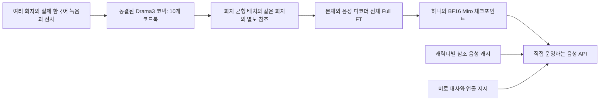
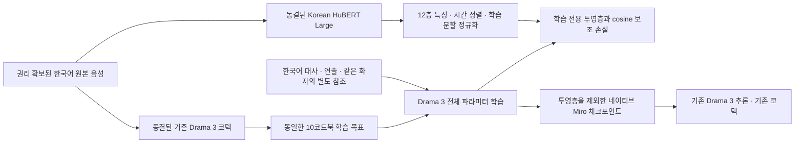

# Miro 한국어 Drama 3 Full Fine-tuning · 한국어 티처 실험

목표는 **여러 화자의 한국어 구어·연기 녹음으로 TTS 모델 전체를 업데이트하고, 하나의 한국어 전용 Miro 체크포인트를 직접 서빙하는 것**이다. LoRA나 화자별 어댑터는 사용하지 않는다. 다른 언어의 성능 유지는 요구하지 않는다.

**Drama 3를 버리는 구조가 아니다.** 공개 Drama 3의 TTS 가중치 전체를 추가 학습해 Miro 체크포인트를 만들고, 이를 기존 Fish 추론 코드로 로딩한다. Korean HuBERT Large는 학습 때만 사용하는 보조 티처다. 배포 모델에 HuBERT와 학습용 투영층은 포함하지 않는다. 현재 실험은 코덱 내부의 원래 시멘틱 티처를 교체하거나 코덱을 재학습한 결과가 아니다.

## 확인한 사실

- 공식 Drama3 배포는 추론 코드와 가중치를 제공하지만, 학습·LoRA·데이터셋 도구를 제거했다고 릴리스 노트에 명시했다. 이 디렉터리는 공식 학습 레시피가 아니라 직접 만든 실험용 학습 경로다.
- 공개 FP8 전문가 가중치는 추론용 버퍼다. Full FT에서는 이를 BF16의 학습 가능한 파라미터로 변환한다. 변환은 원래 양자화 이전 정밀도를 복구하는 작업이 아니다.
- 본체의 임베딩·하이브리드 attention·MoE 전문가·라우터·출력층과 음성 디코더의 모든 가중치를 학습한다. 별도 오디오 토크나이저/코덱은 코드 의미를 유지하기 위해 동결한다.
- 동일 구조의 축소 모델에서261개 파라미터 텐서 전부에 유한한 기울기가 생기고 업데이트됐다. 공식 로더가 읽는 이름으로 내보낸 뒤 같은 손실값으로 재로딩됐다. 이 결과는 실제359억 모델이나 한국어 품질 개선을 입증한 것이 아니다.
- 실제 체크포인트의62,245개 텐서 키를 전부 학습 파라미터에 대응시키는 검사도 통과했다.
- 실제 GPU 2장에서 축소 구조를 ZeRO3로 나누어 전체 파라미터를 두 번 업데이트했다. activation checkpointing과 CPU optimizer offload를 켠 실행도 통과했고, 분산 체크포인트를 다시 합쳐 BF16 모델 파일로 내보냈다. 서로 다른 음성 길이와 한국어 티처 층을 함께 사용하는 검사도 통과했다.
- 실제35,899,643,008개 TTS 파라미터를8×H100에 로딩하고,007 원본 토큰·한국어 티처 특징으로1optimizer step을 완료했다. 전체 TTS 파라미터가 학습 대상이며 LoRA는 없다. 이는 실제 크기의 학습 경로 검증이고, 충분한 파인튜닝·359억 가중치 내보내기·음질 개선을 확인한 결과가 아니다.
- 공식 서빙 요청 스키마와 MsgPack 직렬화도 확인했다. 새 Full FT 모델을 실제로 서빙하거나 음질·지연을 측정한 결과는 아니다.

## 데이터에서 서빙까지



화자 ID는 데이터 관리에 사용한다. 모델 입력의 speaker0~15는 한 요청 안의 역할이며 영구 화자 ID가 아니다. 매 예제에서 역할 번호를 무작위로 배정하고 같은 화자의 참조 녹음을 붙인다. 여러 화자는 같은 모델 가중치를 공유하며, 캐릭터를 바꿀 때 별도 모델을 로딩하지 않는다. 서빙에서는 저장한 reference_id로 참조를 재사용한다.

## 현재 준비된 데이터

007번 원본600클립의 파일 해시와 전사를 확인했다.531개 학습,59개 검증,6개 기존 비교용 시험 대사,4개 고정 참조로 나눴다. 같은 녹음/정규화된 텍스트의 분할 간 중복은 검사했다. 원본 볼륨과 쉼은 변형하지 않았다. 현재는 화자1명이며, **새 녹음이 추가되기 전에는 다중 화자 학습 데이터가 준비됐다고 보지 않는다.**

기존 감정 라벨은 AIHub 파일명 기반이다. 검증된 속삭임 원본이나 같은 대사의 여러 감정 녹음이 존재한다고 가정하지 않는다. 한국어 발음·내용 정확도와 구어 억양·연기 자연스러움은 따로 평가한다. 새 파일을 추가할 때는 고유 speaker_id, 정확한 전사, 실제 녹음에 맞는 연출 라벨을 기록한다.

원본600클립을 GPU 저장소에 올려 고정된 Drama 3 코덱으로 모두 인코딩했다. 같은600클립에서 실제 사전 학습된 Korean HuBERT Large의 특징도 추출했다. 이것은 데이터 준비이며, 실제359억 파라미터 모델의 품질 개선을 뜻하지 않는다.

## 실제 구현

| 파일 | 역할 |
|---|---|
| core.py | 참조·지시문 손실 마스킹, 다음 프레임 정렬, 본체+10코드북 teacher forcing, 전체 파라미터 역전파 |
| data.py | 분할 검사, 화자 균형 샘플링, 같은 화자의 별도 참조 선택, 무작위 역할 슬롯 |
| codec.py | 원본 녹음을 동결된 코덱으로 인코딩. 원본 해시와 코덱 버전 검증 |
| codec_contract.py | 코덱 파일·계산 정밀도·실행 버전과10개 코드북의 범위를 캐시·학습·서빙에서 검증 |
| korean_teacher.py | 한국어 HuBERT 특징의 시간 정렬·학습 분할 통계 정규화·assistant 음성에 대한 보조 손실 |
| train.py / zero3.json | DeepSpeed ZeRO3, BF16, CPU optimizer offload, activation checkpointing, 검증·체크포인트 저장 |
| export.py | ZeRO 체크포인트를 공식 Fish 로더가 읽는 BF16 가중치로 스트리밍 내보내기 |
| serve.sh / serving.env.example | 내보낸 Miro 체크포인트를 직접 로딩하는 공식 Fish API 실행 구성 |
| client.py | 미로 서버에서 reference_id·대사·연출 지시를 보내 WAV를 받는 호출 코드 |
| smoke.py / distributed_smoke.py | 축소 구조의 실제 업데이트·내보내기 및 분산 실행 검사 |
| teacher_smoke.py / teacher_experiment.py | 티처 없는 네이티브 재로딩 검사·실제007 데이터의 대조군 포함 반복 실험 |

손실은 참조나 사용자 텍스트에 직접 걸지 않는다. assistant의 실제 음성 프레임과 종료 토큰만 감독한다. 시점t의 본체는 이전 프레임을 읽고 다음 프레임의 의미 코드를 예측하며, 음성 디코더는 같은 다음 프레임의 앞 코드북을 조건으로 뒤 코드북을 학습한다. 다른 시점으로 코드북을 한 번 더 밀지 않는다. 종료 토큰, 의미 코드,9개 잔차 코드북은 각자의 구간으로 정규화하고 MoE 라우팅 보조 손실을 더한다.

## Korean HuBERT Large를 추가한 구조



티처는 `team-lucid/hubert-large-korean`, revision `62054d17ebf51437336a371a2cdd80d5da2b44ac`로 고정했다. 모델 카드에 한국어 약4,000시간으로 학습한317M Large 모델로 설명돼 있다. 원격 코드는 실행하지 않고 네이티브 HubertModel과 safetensors를 사용했다. 공식 전처리의 `do_normalize=false`를 유지했다.12층의1,024차원 표현을 선택한 것은 첫 실험 조건이며 최적층이라는 검증은 없다.

16kHz 티처의20ms 간격 특징을44.1kHz 코덱의 프레임 중심에 선형 보간한다. HuBERT convolution의 첫 중심은199.5/16000초, 간격은320/16000초다. 이 정렬은 근사적인 시간 대응이며 음소 강제 정렬이 아니다.531개 학습 녹음으로만 채널별 평균·표준편차를 계산하고, 검증·시험 녹음은 통계 계산에서 제외한다. 표준편차 하한0.05, 정규화 값 범위±10을 사용한다.

학습 목표는 `L = L_speech + 0.1 * mean(1 - cosine(W h_t, stopgrad(z_t)))`이다. `h_t`는 다음 음성 프레임을 예측하기 직전의 본체 은닉 상태, `z_t`는 해당 목표 프레임의 정렬·정규화된 티처 특징이다. 직접적인 보조 손실은 assistant 음성에만 적용하고 참조·지시문·종료 토큰에는 적용하지 않는다. 티처는 동결하고 본체·코드북 디코더 전체와 새 투영층을 학습한다. 이 보조 손실이 한국어 발음·연기 개선을 보장하지 않으며, 코덱이 이미 잃은 정보를 추론 때 복구하는 구조도 아니다.

## 실제007 데이터의 대조 실험 결과

실제359억 모델에 긴 학습을 걸기 전에, 같은 네이티브 연산 구조를 줄인85,114,608파라미터 모델에서 학습 신호를 확인했다. **TTS는 무작위 초기화된 축소 모델이며 사전 학습된 Drama 3 음질 실험이 아니다.** 티처만 실제 사전 학습 가중치를 사용했다.

학습64개·검증16개를 neutral/happy/sad/angry별 동일 개수로 고르고, 목표와 다른 중립 참조1개를 고정했다. 각 초기값에서 같은 시작 가중치·같은 데이터 순서로 기존 음성 손실, 한국어 티처 추가, 다른 녹음의 티처 특징을 준 대조군을 각각64steps 학습했다. 초기값3개, 총9회576optimizer steps다. TTS 학습률1e-4, 학습용 투영층5e-4, 보조 손실 가중치0.1이다.

비교 지표는 보조 손실을 제외한 검증 음성 손실이며 낮을수록 좋다. 청취 점수나 발음 오류율이 아니다.

| 초기값 | 기존 방식 | 한국어 티처 | 다른 녹음의 티처 | 한국어 티처의 기존 대비 변화 |
|---|---:|---:|---:|---:|
|31415|18.7731|18.7192|18.7543|−0.287%|
|1618|17.0974|17.4077|17.4128|+1.815%|
|2718|17.5517|17.5875|17.4407|+0.204%|

**일관된 개선이 없었다.** 세 초기값 중 한 번만 기존 방식보다 낮았고 평균 상대 변화는+0.577%였다. 올바른 티처가 다른 녹음의 티처보다도 항상 좋지는 않았다. 이 설정을 품질 개선안으로 확정하거나 운영 모델에 반영하지 않는다. 축소 모델의 결과만으로 실제 사전 학습된359억 모델에서 티처가 효과 없다고 단정할 수도 없다.

9회 모두261개 TTS 파라미터 텐서가 실제 업데이트됐고, 학습용 투영층을 제거한 공식 네이티브 구조의 재로딩 검사도 통과했다. 별도 회귀 검사에서는 티처 없는 내보내기·재로딩 후 음성 손실이 정확히 같았고, 스트리밍 체크포인트 리더의 재로딩도 통과했다. 이는 형식·연산 호환성의 증거이며 실제 크기의 학습 완료·서빙·음질 검증은 아니다.

실제 크기의 첫 통합 검사에서 가중치 로딩·optimizer 초기화까지 통과했지만 업데이트는 완료되지 않았다. 코드를 조사해 문장 길이마다 LM 출력층을32프레임씩 호출하는 횟수가 달라져 ZeRO3 통신 순서가 달라질 수 있는 문제를 수정했다. 분산 실행에서는 최대 호출 횟수를 맞추고 부족한 호출은 손실0인 더미 계산을 사용한다. 길이25/73프레임의 서로 다른 목표와 티처 층을 사용한2GPU·CPU offload 검사에서2steps와 ZeRO 저장·티처 층 제외 BF16 내보내기까지 통과했다. 첫 실제 크기 실행은 중단하고 수정한 코드로 제한된 재검사를 실행했다. 또한 체크포인트 shard를 매 텐서마다 다시 여는 방식을 고쳐 shard별 핸들을 재사용한다.

[이 실험의 상세 결과](/Users/johyeon-ung/Desktop/Miro/output/voice-compare/drama3-korean-teacher-007-20261023/RESULTS.md)

사용자의 후속 요청으로 실제 사전 학습된359억 모델의 공정한 대조 학습도 별도로 시작했다. 두 방식 모두25회·동일한400개 예제·같은 초기값/학습률/참조/검증 계획을 사용한다.2026-10-23 현재 기존 방식5회 후 Modal의US$10 결제 실패로 계정이 중지돼, 한국어 티처 방식과 학습 후 음성 비교는 완료하지 못했다. 이전의 티처 포함359억1step 검사는 이 대조 실험과 구분한다.

실제 크기 대조 실험에는 `matched_fullsize.py`, `live_export.py`, `modal_drama3_fullsize_train.py`, `modal_drama3_fullsize_listen.py`를 사용한다. 라이브 ZeRO 파티션에서 optimizer 상태 없이 네이티브 추론 가중치를 저장하는 경로는2GPU 검사에서 기존 ZeRO 재구성 값과 정확히 일치했다. 계정 재활성화 후 중단 시도를 보존하고 같은 원본에서 재실행할 수 있다. 저장되지 않은 optimizer 상태를 정확히 복구하는 기능은 아니다.

[실제 모델 비교의 현재 상태와 재실행 경로](/Users/johyeon-ung/Desktop/Miro/output/voice-compare/drama3-fullsize-ab-007-20261023/RESULTS.md)

GPU 호스트에서 기존 학습 명령에 `--teacher-features /data/teacher_features --teacher-weight 0.1`을 붙이면 이 경로가 켜진다. 캐시와 학습 분할 통계가 먼저 준비돼 있어야 한다. 아무 옵션도 주지 않으면 기존 음성 손실만 사용한다. 아래 Modal 실행기는 캐시 생성·대조 실험·실제 크기1step 검사를 구분한다.

```bash
modal run tooling/voice/modal_drama3_korean_teacher.py --folder output/voice-compare/drama3-korean-teacher-007-20261023
modal run tooling/voice/modal_drama3_korean_teacher.py --folder output/voice-compare/drama3-korean-teacher-007-20261023 --pilot-only
modal run tooling/voice/modal_drama3_korean_teacher.py --folder output/voice-compare/drama3-korean-teacher-007-20261023 --extra-seeds
modal run tooling/voice/modal_drama3_korean_teacher.py --folder output/voice-compare/drama3-korean-teacher-007-20261023 --validate-only
modal run tooling/voice/modal_drama3_teacher_fullsize.py --folder output/voice-compare/drama3-korean-teacher-007-20261023 --run-tag fullsize_newrun
```

실제 크기 검사의 run-tag는 매 실행 새로운 이름을 사용한다. 이미 실행 결과가 있는 디렉터리를 덮어쓰지 않는다. 이번에 성공한 실행 태그는 `fullsize_memory_retry`다. 실행기 기본은1step 후 종료하며 배포 가중치를 내보내지 않는다.

현재 구조는 기술 검증용이며, 충분히 학습된 모델의 재현 레시피가 아니다. 미세한 수치 개선을 찾으려고 대규모 학습을 반복하지 않는다. 실제 사전 학습 모델의 대조 실험과 보지 못한 대사 청취에서 개선이 확인돼야 채택한다.007번 데이터에는 검증된 속삭임 원본이 없어 이 실험으로 속삭임·ASMR 학습까지 해결했다고 볼 수 없다.

## 한국어 코덱 병목 실험 반영

007번23개 원본을 생성 모델 없이 코덱으로 복원했다. FP32 복원의 피치 곡선 상관 중앙값0.9980, 강약 곡선0.9981, 쉼 비율 변화 중앙값+0.316%p였다. BF164클립 복원도 비슷한 특징을 보였다. 한국어 ASR 오류는 평균적으로 증가하지 않았다. 이는 음질·감정 자연스러움의 청취 점수가 아니며, 속삭임 원본이나 다른 화자까지 검증한 결과도 아니다.

첫 시멘틱 코드북만 남기는 실험은 피치 보존이 크게 나빠졌지만, 실제10개 코드북 복원에서는 대부분 유지됐다. 따라서 현 데이터에서 코덱이나 티처 교체를 정당화할 근거는 부족하다. 인코더·코드북·파형 디코더를 유지하고, TTS 본체와 codebook-MTP 전체 Full FT를 계속 준비한다. 실제 한국어 연기 데이터 분포는 추가 녹음으로 보강해야 한다.

대신 FP32/BF16의 토큰 번호 전체 일치율은4클립에서 약49~56%였다. 이는 해당 음질 저하율을 뜻하지 않으며 두 정밀도의 복원 특징은 비슷했다. 그럼에도 토큰 파일을 섞어 학습해서는 안 되므로 코덱 해시·정밀도·Torch 버전을 묶는 codec_contract를 추가했다. 현재 네이티브 서빙에 맞춘 기본은 BF16이다. FP32 캐시를 본학습에 쓰려면 먼저 서빙 쪽 정밀도를 맞춰야 하며 현재 진입 검사는 이를 거절한다. 계약 없는 과거 캐시도 새 디렉터리에서 다시 만들어야 한다.

이 계약은 버전·정밀도 혼용을 막는 검사다. GPU 종류나 커널까지 포함한 모든 환경에서 비트 단위 토큰 동일성을 보장하지는 않는다. 향후 코덱 수정이 필요하면 먼저 동결된 인코더·코드북을 유지하는 파형 디코더 학습부터 검토한다. 그 경로도 보지 못한 녹음에서 개선이 입증되기 전에는 채택하지 않는다.

정밀도가 다르다고 코드북 번호의 의미가 새로 매핑되거나, 서로 다른 정밀도의 유효 토큰을 함께 쓰는 일이 원천적으로 불가능한 것은 아니다. 이번 검사는 비교 실험의 전처리 조건을 고정하고 출처가 불명확한 캐시를 차단하기 위한 보수적인 정책이다. codec_profile_id는 이 실행 프로필을 식별한다.

[전체 코덱 조사·실험 결과](/Users/johyeon-ung/Desktop/Miro/output/voice-compare/drama3-codec-audit-007-20261023/RESULTS.md)

## 하드웨어 계획과 아직 남은 검증

실제 TTS 파라미터 수는35,899,643,008개다. BF16 가중치만66.87GiB, 일반적인 mixed-precision Adam 학습 상태만 약534.95GiB다. 활성값·파라미터 모으기·통신 버퍼·코덱은 별도다. 활성 파라미터가 약3B인 MoE여도 전체 가중치와 학습 상태는 전체 규모에 맞춰 필요하다.

처음에는 **H10080GB급8장 + CPU RAM512GiB 상한 + optimizer CPU offload**로 시도했다. 실제359억 모델과007 데이터의 가변 길이 배치에서8개 GPU 모두 순전파·역전파를 완료했지만 optimizer 업데이트 도중 컨테이너가 메모리 부족으로 종료됐다(exit137). 이 조건에서512GiB 상한은 충분하지 않았다. CPU offload의 실제 FP32 버퍼와 순간 추가 할당은 단순한 mixed-precision 상태 계산만으로 보장할 수 없다.

확인된 메모리 부족을 반영해 제한된1step 재검사에서는 **CPU RAM640GiB 요청·768GiB 상한**으로 조정했고 실제 업데이트까지 통과했다. global gradient norm25.12951,rank0 GPU 할당 최대22.775GiB였다. 컨테이너의 MemTotal−MemAvailable을0.5초마다 관측한 CPU 메모리 최대는 약697.04GiB였다. 이는 프로세스별RSS나 정확한 하드웨어 최고치가 아닌 근사 관측값이다. 초기화·가중치 로딩을 포함해302.04초가 걸렸으므로 이를step당 처리 시간으로 해석하면 안 된다. 더 긴 입력·반복steps·실제359억 체크포인트 저장·내보내기의 메모리는 아직 검증하지 않았다.

작은 구조의 검사는 실제 크기의 검사나 음질 검증을 대체하지 않는다. 검증한 컨테이너에서는 CPUAdam 빌드와 실행이 성공했다. 본학습 환경에서도 같은 의존성과 빌드 환경을 유지해야 한다.

처음에는25optimizer steps의 짧은 pilot과5steps마다 화자별 검증을 사용하도록 준비했다. 이 횟수가 충분한 품질이나 최적 설정을 뜻하지 않는다. 현재 한국어 티처의 이득이 검증되지 않아 이 옵션으로 장시간 본학습을 실행하지 않았다. 실제 사전 학습 모델에서의 공정한 대조·청취와 새 연기 녹음의 준비 상태에 따라 후속 학습을 결정한다.

BF16 전체 모델 파일은 Mac으로 내려받지 않고 GPU 서버 저장소에서 관리한다. 현재 설계의 서빙은2개 GPU에 나눠 로딩하는 구성으로 시작하며, 실제 동시 처리량과 지연은 아직 측정하지 않았다. 운영 앱은 변경하지 않았다.

## GPU 호스트에서 실행하는 경로

아래는 실행 인터페이스이며 본학습 실행 기록이 아니다. 이 디렉터리를 PYTHONPATH에 넣고 고정된 Fish 소스가 설치된 CUDA 개발 환경에서 사용한다.

```bash
python -m drama3_fullft.data /data/recordings.jsonl
python -m drama3_fullft.codec --manifest /data/recordings.jsonl --checkpoint /models/drama3-original --output /data/drama3-codes
deepspeed --num_gpus 8 --module drama3_fullft.train --checkpoint /models/drama3-original --manifest /data/recordings.jsonl --codes /data/drama3-codes --output /runs/miro-ko-v1 --deepspeed-config /code/drama3_fullft/zero3.json --max-steps 25
python -m drama3_fullft.export --zero-checkpoint /runs/miro-ko-v1/checkpoints --original /models/drama3-original --output /models/miro-drama3-ko-fullft-v1
```

서빙 호스트에서도 이 패키지의 상위 디렉터리를 PYTHONPATH에 넣는다. serving.env.example의 경로와 비밀 키를 환경변수로 설정하고, 고정된 Fish 소스 디렉터리에서 serve.sh를 실행한다. 내보낸 codec_contract.json과 실제 codec.pth 해시·정밀도·런타임 검사를 먼저 통과해야 한다. 기본 바인딩은 localhost이며 서비스 키는 브라우저에 노출하지 않는다. 새 체크포인트의 실제 대사·목소리 유지·한국어 연기 비교를 통과하기 전에는 운영 모델로 교체하지 않는다.

## 근거와 재현 기록

- [공식 배포와 학습 코드 제거 명시](https://github.com/fishaudio/fish-speech/releases/tag/v3.0.0-beta)
- [Drama3 논문의 학습·assistant 손실·코드북 정렬](https://arxiv.org/html/2610.18010v2)
- [사용한 고정 소스](https://github.com/fishaudio/fish-speech/tree/541566932abbaebcb0a40e562a1f846738383f38)
- [ZeRO3의 파라미터·기울기·optimizer 분할](https://www.deepspeed.ai/tutorials/zero/)
- [Korean HuBERT Large 공식 모델 카드](https://huggingface.co/team-lucid/hubert-large-korean)
- 모델 revision: b2b5ee998034b2975720906c815e7fb0e9f007bd
- 실행 결과: output/voice-compare/drama3-training-readiness-20261023 아래 JSON과 로그
- [현재 검증 결과와 남은 단계](/Users/johyeon-ung/Desktop/Miro/output/voice-compare/drama3-training-readiness-20261023/RESULTS.md)

Built with Fish Audio. 현재 대화에서 확인된 이용 조건과 권리 확보된 녹음을 전제로 준비했다.

## 2026-10-23 추가 중단과 보존 수정

한국어 티처 실제 모델 한 개를20회 업데이트한 실행은 추가US$20 분할 청구 결제 실패로 종료됐다. 중간 가중치가 없어서20회 상태를 복구할 수 없다. GPU는 종료했고 자동 재실행하지 않는다.

재발 시 학습 가중치를 보존하도록 `matched_fullsize.py`에10회·20회 네이티브 스냅샷을 추가했다. `snapshots.py`는 내보내기 완료 마커·모든 shard를 확인한 후 최신 완료 포인터를 교체한다. 부모 Modal 함수는 완료 이벤트를 받은 즉시 Volume을 commit한다. 로컬CPU 회귀 검사3개는 통과했으며 실제35B GPU 저장 검증은 아직 없다. 전체Adam optimizer 상태는 저장하지 않으므로 정확한 이어 학습 기능이라고 부르지 않는다. 다음 유료 실행의 예산에는 중간 저장 시간과 저장 공간을 다시 포함해야 한다.
